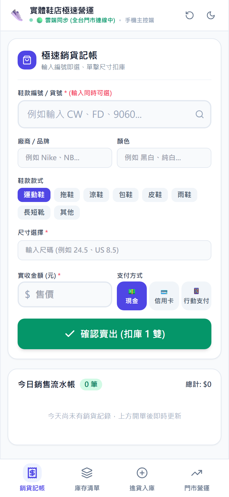
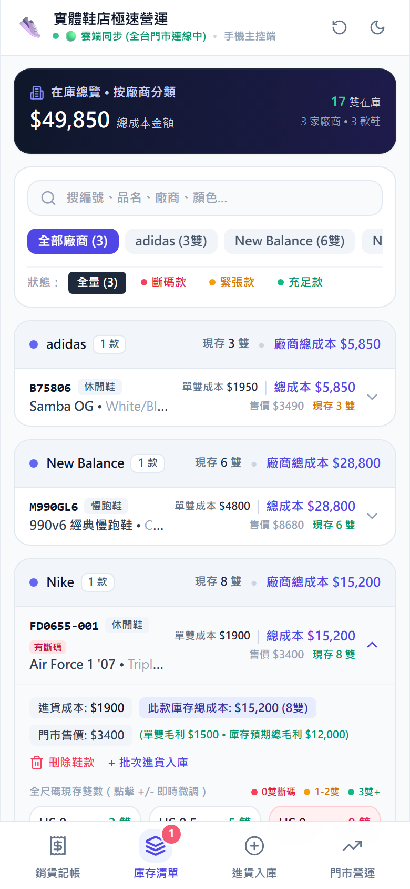
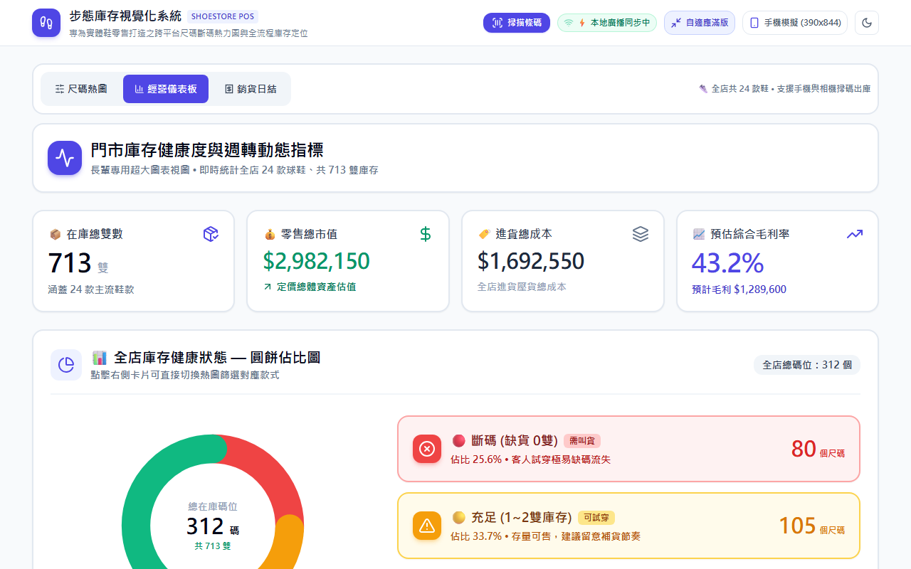
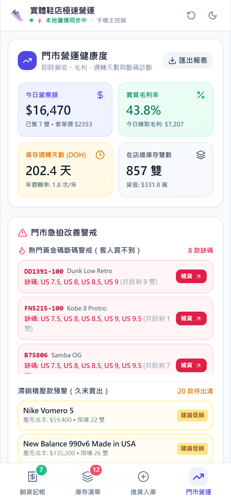
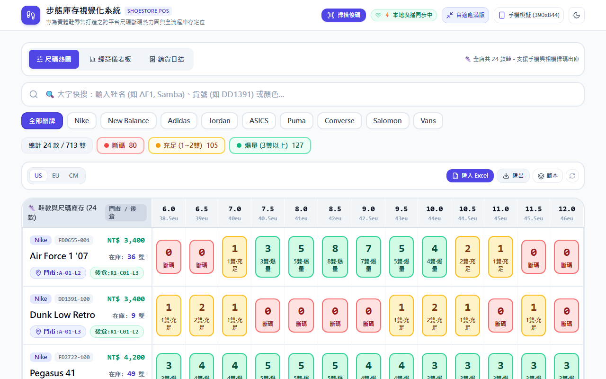

# Shoe Store Inventory System — Portfolio Demo

[](https://react.dev/)
[](https://www.typescriptlang.org/)
[](https://vitejs.dev/)
[](https://tailwindcss.com/)
[](https://playwright.dev/)
[](https://mudechen.github.io/shoe-store-demo/)

A production-grade, mobile-first inventory management system built for a physical shoe retail store in Taiwan. Features real-time POS, FIFO cost accounting, barcode scanning, 2D warehouse mapping, and 29 E2E test specifications.

> **⚠️ Demo Notice**: This is a sanitized version of a production system. All cost/pricing data shown is **fictional** and for demonstration purposes only. The live production version uses Supabase for multi-device sync; this demo runs entirely in the browser using `localStorage`.

---

## 🔗 Live Demo

**[▶ Launch Demo](https://mudechen.github.io/shoe-store-demo/)** — No login required. Best experienced on mobile (390×844) or desktop (1280×800).

---

## 📸 Screenshots

| Mobile POS | Mobile Inventory | Dashboard |
|:---:|:---:|:---:|
|  |  |  |

| Analytics | Size Matrix Heatmap | Desktop View |
|:---:|:---:|:---:|
|  |  |  |

---

## 🏗️ Architecture & Tech Stack

| Layer | Technology | Rationale |
|:------|:-----------|:----------|
| **UI Framework** | React 18.3 | Concurrent rendering, Hooks-based architecture |
| **Language** | TypeScript 5.6 (strict) | End-to-end type safety across 50+ source files |
| **Build Tool** | Vite 5.4 | Sub-second HMR, optimized chunking with content-hash |
| **Styling** | Tailwind CSS 3.4 | Utility-first, dark mode, container queries for responsive grids |
| **State** | `useState` + `localStorage` | No external state library needed — domain state is simple, persistence is key |
| **Real-time Sync** | Supabase Realtime + BroadcastChannel | Dual-tier: cloud sync for multi-store, local fallback for multi-tab |
| **Spreadsheet I/O** | SheetJS (xlsx) | Matrix unpivot for size-grid Excel import/export |
| **Testing** | Playwright 1.48 | 29 E2E specs, dual-viewport (desktop 1280×800 + mobile 390×844) |
| **Hosting** | GitHub Pages (demo) | Zero-cost static hosting for portfolio showcase |

---

## ✨ Key Features

### 📦 Inventory Management
- **Size Matrix Heatmap** — Traffic-light visualization (🔴 out / 🟡 low / 🟢 sufficient) across US/EU/CM size standards
- **Full Size Grid Invariance** — Always displays min-to-max range; zero-stock sizes maintain placeholder positions
- **Brand/Category/Shelf Filtering** — Drawer-based multi-facet filter with real-time count badges

### 💰 Point of Sale (POS)
- **Quick Cashier** — Sub-2-tap checkout flow optimized for store clerks on mobile
- **Barcode Scanning** — Camera-based real barcode scanning + test simulator
- **FIFO Cost Deduction** — Each sale automatically deducts from the oldest inventory batch

### 📋 Customer Reservations
- **Lifecycle Tracking** — Pending → Arrived → Picked Up, with deposit/balance management
- **Auto-matching** — Incoming stock automatically flags matching pending reservations

### 📊 Analytics & Records
- **Daily Sales Closing** — End-of-day revenue, profit margin, and payment method breakdown
- **Stock-In Ledger** — Full audit trail with cost revision versioning (historical records preserved)
- **Vendor Returns** — Defect/slow-moving return workflows with automatic stock adjustment

### 🗺️ Spatial Warehouse Map
- **2D Floor Plan** — Storefront zones (A–D) and backroom racks (R1–R4, 5 tiers × 6 columns)
- **Bidirectional Navigation** — Click a product → shelf flashes; click a shelf → product list drawer

---

## 🧠 Engineering Highlights

### 1. FIFO Batch Cost Accounting

Each stock-in event creates cost batches attached to size variants. When a sale occurs, the system deducts from the **oldest batch first**, ensuring accurate per-unit profit margin calculation.

```typescript
interface InventoryBatch {
  batchId: string;      // Links to StockInRecord
  costPerPair: number;  // Frozen at time of stock-in
  quantity: number;     // Remaining units in this batch
  date: string;         // Stock-in date for FIFO ordering
}
```

Sales and customer returns both interact with the batch queue — sales dequeue, returns re-enqueue at the original position.

### 2. Cost Revision Versioning

Historical stock-in records are **never overwritten**. When a cost is revised:
- The original record is marked `isSuperseded: true` and visually struck through
- A new revision record inherits the original business date but carries a `costModifiedAt` timestamp and incremented `revisionNo`
- All ledger summations (total pairs, total cost, KPI badges) strictly filter `!record.isSuperseded`
- Active inventory batches are synchronized to reflect the updated cost for future FIFO deductions

### 3. Full Size Grid Invariance

Size grids in inventory, sales, and reservation views always render the **complete range** from `minSize` to `maxSize`:

- Step interval auto-detected: whole (1.0) for integer-only products, half (0.5) for products with decimal sizes
- Zero-stock sizes maintain card placeholders with `[+]` quick-add capability
- Any existing stock outside the configured range is **force-displayed** — inventory is never hidden
- Sales checkout disables zero-stock size buttons to prevent negative inventory

### 4. Touch Ergonomics & Anti-Mistouch Design

Designed for store clerks operating on phone screens during transactions:

- **No truncation on critical identifiers** — Sizes, prices, and barcodes always use `whitespace-nowrap`
- **Number input spinners removed** — `[appearance:textfield]` prevents 2-digit values from being clipped at 100–125% font scale
- **No wheel-drum pickers** — Standard `<select>` dropdowns prevent accidental scroll-through in forms
- **Quantity adjusters** — Two-sided layout (`[-] qty [+]`) with auto-highlighting when qty > 0

### 5. Dual-Tier Real-Time Sync

```
┌─────────────────────────────────────────────┐
│  Tier A: Supabase Realtime WebSocket        │
│  (Cross-device, multi-store cloud sync)     │
├─────────────────────────────────────────────┤
│  Tier B: HTML5 BroadcastChannel             │
│  (Same-browser, multi-tab zero-latency)     │
└─────────────────────────────────────────────┘
```

Tier B serves as an instant fallback when cloud connectivity is unavailable. Both tiers broadcast the same event schema, making the sync layer transparent to the UI.

### 6. 7-Tier E2E Testing Strategy

29 Playwright specs organized into escalating tiers:

| Tier | Focus | Description |
|:-----|:------|:------------|
| **T1** | Core Smoke | Seed data loading, heatmap rendering, size switching, search |
| **T2** | Boundary | Dirty data blocking, negative stock prevention, edge sizes |
| **T3** | Cross-Feature | Product → shelf navigation, shelf → product drawer |
| **T4** | Real-World Mobile | 390×844 viewport, no horizontal overflow, quick checkout flow |
| **T5** | Advanced Features | Barcode scanning, sync indicators, health metrics, export |
| **T6** | Daily Sales Closing | End-of-day reports, multi-payment breakdown, date filtering |
| **T7** | Records & Stock-In | Ledger CRUD, cost revision, vendor returns, multi-size batch |

Every spec runs against both desktop (1280×800) and mobile (390×844) viewports.

### 7. 2D Spatial Warehouse Positioning

The spatial map provides a **physical-to-digital bridge** for store operations:

- **Storefront** (Zones A–D): Display shelves organized by brand affinity
- **Backroom** (Racks R1–R4): 5-tier × 6-column steel racks with visual slot occupancy
- **Bidirectional lookup**: Tap a product card → its shelf slot flashes with animation; tap a shelf slot → opens a drawer listing all products stored there

---

## 🧪 Testing Strategy

```bash
# Run all E2E tests
npm test

# Run specific tier
npx playwright test tier1-core
npx playwright test --grep "FIFO"
```

Tests validate **intent, not just behavior** — if business rules change (e.g., switching from FIFO to LIFO), the corresponding tests must fail.

---

## 🚀 Quick Start

```bash
# Clone the repository
git clone https://github.com/mudechen/shoe-store-demo.git
cd shoe-store-demo

# Install dependencies
npm install

# Start development server
npm run dev
# → http://localhost:5173/shoe-store-demo/

# Build for production
npm run build

# Deploy to GitHub Pages
npm run deploy:demo
```

### Optional: Supabase Integration

Copy `.env.example` to `.env` and fill in your Supabase credentials to enable multi-device cloud sync. Without these, the app runs entirely in local `localStorage` mode.

---

## 📁 Project Structure

```
src/
├── App.tsx                          # Root component (state machine, tab routing)
├── main.tsx                         # React 18 DOM entry
├── components/
│   ├── Analytics/                   # Store-wide analytics dashboard
│   ├── Dashboard/                   # Health metrics, restock alerts
│   ├── ExcelManager/                # Excel/CSV import with validation
│   ├── Home/                        # Home workbench with KPI cards
│   ├── Inventory/                   # Compact inventory list + filter drawer
│   ├── MatrixHeatmap/               # Size matrix heatmap (US/EU/CM)
│   ├── Navigation/                  # Mobile bottom nav + responsive nav
│   ├── Records/                     # Sales ledger, stock-in ledger, vendor returns
│   ├── Reservations/                # Customer reservation lifecycle
│   ├── Sales/                       # Quick cashier POS
│   ├── SalesClosing/                # End-of-day settlement
│   ├── Scanner/                     # Barcode camera scanner
│   ├── SpatialMap/                  # 2D warehouse floor plan
│   ├── StockIn/                     # Stock-in form + size range picker
│   └── VendorReturn/                # Vendor return workflow
├── data/
│   ├── seedShoes.ts                 # 28 product seed definitions
│   ├── seedRecords.ts               # Stock-in & vendor return seeds
│   ├── seedSales.ts                 # Sales record seeds
│   ├── sizeStandards.ts             # US/EU/CM conversion tables
│   └── storeLayout.ts              # Shelf geometry configuration
├── services/
│   ├── analyticsService.ts          # Revenue & turnover calculations
│   ├── barcodeService.ts            # Barcode encoding/lookup
│   ├── excelService.ts              # SheetJS import/export
│   ├── fifoService.ts               # FIFO batch deduction/restoration
│   ├── realtimeService.ts           # Dual-tier sync orchestration
│   └── salesService.ts              # Daily closing & margin stats
├── types/                           # TypeScript interfaces (inventory, sales, records, etc.)
└── utils/                           # Date (Asia/Taipei TZ), formatters, validators
```

---

## 👤 About the Developer

**Mu-De Chen (陳沐德)**

- GitHub: [@mudechen](https://github.com/mudechen)
- This project demonstrates my approach to building production software: strong typing, domain-driven architecture, mobile-first UX, rigorous testing, and attention to real-world operational constraints.
